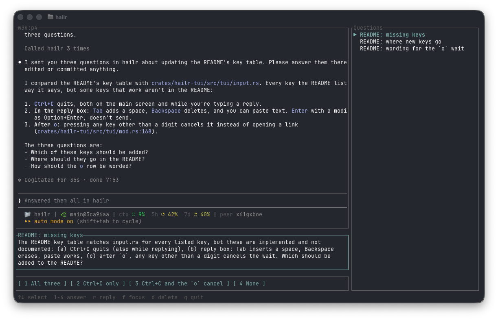

# hailr

A TUI that collects questions and permission prompts from Claude Code sessions running in herdr panes, so you can answer them all in one place.
Claude asks a question with the `ask_human` tool and ends its turn. Your answer in the TUI reaches Claude through a channel.



## Requirements

- herdr
- Rust (stable)
- Node 26 or later and pnpm
- Claude Code, logged in with claude.ai or a Console API key (channels require it)

## Install

Run these from the repository root.

1. Install the TUI

   ```sh
   cargo install --path crates/hailr-tui
   ```

2. Install the ask-mcp dependencies

   ```sh
   pnpm install
   ```

3. Register ask-mcp with Claude Code under the name `hailr`

   ```sh
   claude mcp add --scope user hailr -- node "$PWD/packages/ask-mcp/src/main.ts"
   ```

## Usage

1. Start `hailr` in a herdr pane
2. In another pane, start Claude Code with the channel. It warns about development channels; choose the option that says you are using it for local development

   ```sh
   claude --dangerously-load-development-channels server:hailr
   ```

3. When Claude calls `ask_human`, the question appears in the TUI. When a permission dialog appears in the terminal, the same prompt appears as an Allow / Deny question, and whichever you answer first is used

| Key | Action |
|---|---|
| `↑` `↓` (`k` `j`) | Select a question |
| `1`–`9` | Answer with a button |
| `o` then a digit | Open a link |
| `r` | Type a reply (Enter sends, Esc cancels) |
| `f` | Move herdr's view to that pane. If herdr is open in Ghostty, its window comes to the front. After moving, answering a permission prompt in the pane removes it from the list (questions from `ask_human` stay, so remove them with `d`) |
| `d` | Remove a question. Claude is told you removed it without answering. For a permission prompt, nothing is sent and the terminal dialog stays |
| `q` | Quit |

You can also click questions, buttons and links.

## Configuration

Settings go in `~/.config/hailr/config.toml`. Every setting is optional.

| Setting | Default | Description |
|---|---|---|
| `[ui] questions` | `"right"` | Which side the question list is on: `"left"` or `"right"` |
| `[ui] answered_delay` | `1.5` | Seconds an answered question stays in the list, at most 1 hour. `0` removes it right away |
| `[notify] toast` | `false` | Show a herdr notification when a new question arrives |

```toml
[ui]
questions = "left"
answered_delay = 0.5

[notify]
toast = true
```
